<!-- Hero banner -->

  

  

  <b>I build systems that have to be right: state estimation, money decisions, and the tools that let AI agents ship code.</b>

  
  

## 🚀 Currently

- 🎓 **Junior at Wake Forest University**, studying Computer Science + Finance
- 💼 **Software Engineer at Steward Technologies**: fintech rewards decision engine, iOS (SwiftUI) + backend, on a 3-person engineering team
- 🔭 Looking for **Summer 2027 Software Engineering / AI internships**

## 🛠️ Featured Work

  

| Project | What it is | Results |
|---|---|---|
| 🛰️ **denied-signal-stack** Python · C++ · 🔒 private, demo on request | GPS-denied drone localization: OpenVINS visual-inertial odometry, an 18-state error-state EKF, satellite map matching, and integrity monitoring (HPL/VPL, RAIM) | **1.18 m** median RMSE with GPS denied · spoof detection in **1.8–3.8 s** (median 2.8 s) · **0** hazardously misleading epochs · **1,227** tests passing Simulation results: 9 scenarios × 5 seeds |
| 🖥️ **[terminal-canvas](https://github.com/alexnieves-cs/terminal-canvas)** Electron · React · TypeScript · public | A macOS app where Claude Code and Codex agents run in real terminals on an infinite canvas, with agent hand-offs and tmux persistence | Shipped **v6.0.0**, with a visual-regression test suite |
| 💳 **Steward** Swift · SwiftUI · backend · 🔒 company work | A cross-issuer rewards decision engine, plus a booking matrix that prices 7 payment methods per trip leg | Company work at Steward Technologies |

## 🧰 Tech Stack

  

  <b>Languages:</b> Python · TypeScript · Swift · C++ &nbsp;|&nbsp;
  <b>Frameworks:</b> SwiftUI · React · Electron &nbsp;|&nbsp;
  <b>Quality:</b> pytest · GitHub CI 
  <b>AI agents:</b> Claude Code · Codex · Cursor · MCP

## 📊 GitHub Stats

  <picture>
    <source media="(prefers-color-scheme: dark)" srcset="https://github-readme-stats.vercel.app/api?username=alexnieves-cs&show_icons=true&hide_border=true&count_private=true&theme=tokyonight"/>
    
  </picture>
  <picture>
    <source media="(prefers-color-scheme: dark)" srcset="https://streak-stats.demolab.com?user=alexnieves-cs&hide_border=true&theme=tokyonight"/>
    
  </picture>

  <picture>
    <source media="(prefers-color-scheme: dark)" srcset="https://github-readme-stats.vercel.app/api/top-langs/?username=alexnieves-cs&layout=compact&hide_border=true&theme=tokyonight"/>
    
  </picture>

  <picture>
    <source media="(prefers-color-scheme: dark)" srcset="https://raw.githubusercontent.com/alexnieves-cs/alexnieves-cs/output/github-snake-dark.svg"/>
    
  </picture>

## 📫 Let's Talk

I'm happy to give a live demo of denied-signal-stack, or talk about state estimation, fintech, or AI-agent tooling.
Reach me on **[LinkedIn](https://www.linkedin.com/in/alex-nieves-wfu)**.

